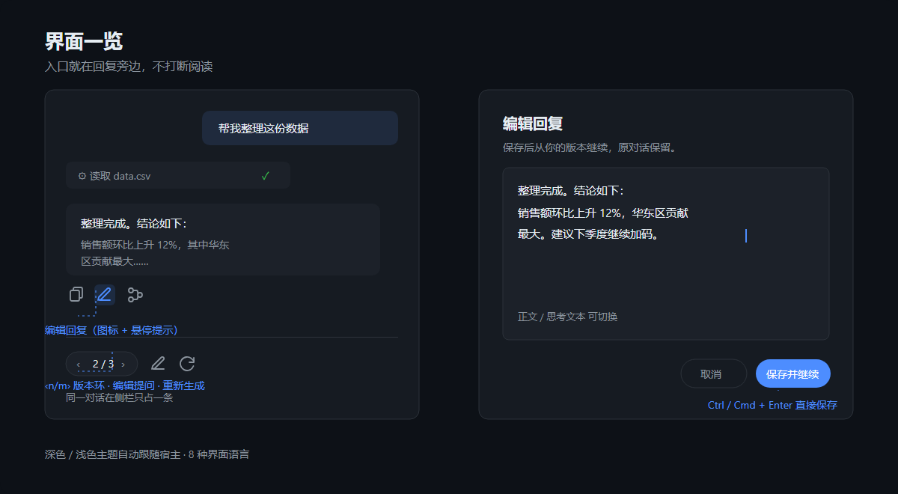

<p align="center">
  
</p>

<h1 align="center">The Last Word · 最终解释权</h1>

<p align="center"><strong>You get the last word.</strong></p>

<p align="center">
  <a href="LICENSE"></a>
  
  
  
  
  <a href="https://github.com/Ylsssq926/dsh-last-word/stargazers"></a>
</p>

<p align="center">
  <a href="README.md">中文</a> ·
  English ·
  <a href="README.ja.md">日本語</a> ·
  <a href="README.es.md">Español</a> ·
  <a href="README.fr.md">Français</a> ·
  <a href="README.de.md">Deutsch</a> ·
  <a href="README.ru.md">Русский</a> ·
  <a href="README.pt.md">Português</a>
</p>

The model's reply is a draft. Delete the lecture, keep the conclusion, get back to work — no regeneration, no second burn of tokens.

## Three actions

| Action | Entry | Result |
|---|---|---|
| Edit reply | Pencil icon beside the reply | Rewrite the final reply (body or reasoning) and continue |
| Edit prompt | Pencil icon at the turn tail | Change this prompt and regenerate |
| Regenerate | Retry icon at the turn tail | Same prompt, run the turn again |

## Why install it

**Edit the reply, don't re-run the tools.** Every lookup, command and file change stays on record. You only rewrite the final answer — the task never starts over.

**Switch versions like flipping drafts.** One sidebar entry per conversation; flip between versions with ‹n/m› under the turn, archived ones included. Changed your mind? Flip back.

**Rewrite the prompt mid-answer.** See the model going off track? Don't wait for it to finish — change the prompt and start over. Streaming replies stop automatically, so no tokens burn on an answer nobody will read.

**The original conversation is always there.** Every edit keeps a copy; switch to another version whenever you like.

## The interface

<p align="center">
  
</p>

Entries sit right beside the reply without breaking your reading flow. Dark / light themes follow the host; the interface speaks 8 languages.

## What one edit does

<p align="center">
  
</p>

## Install

```bash
dsh plugin --profile web add github:Ylsssq926/dsh-last-word
```

Use `--profile desktop` for the desktop app. Restart DSH and enable the plugin.

For local development you can link a directory instead:

```bash
dsh plugin --profile web add link:/absolute/path/to/model-response-editor
```

## Thoughtful details

- The dialog autofocuses; `Ctrl / Cmd + Enter` saves, `Esc` cancels.
- Body and reasoning text edit separately, one click to switch.
- The ‹n/m› ring shows which version you're on; archived versions switch back directly.
- Editing the prompt mid-generation stops the old reply automatically.
- Errors tell you what to do next, not jargon.

## Compatibility

- DSH `>=0.2.2-rc.1 <0.3.0`, web and desktop.
- Interface languages: 中文, English, 日本語, Español, Français, Deutsch, Русский, Português.

## Development

```bash
pnpm install
npm test   # 9 regression groups: branching, versions, sidebar, navigation, tool records…
```

## License

Apache-2.0. If you reference or redistribute this plugin, keep the attribution in [LICENSE](LICENSE) and [NOTICE](NOTICE).

掠蓝 · QQ group: 676475076