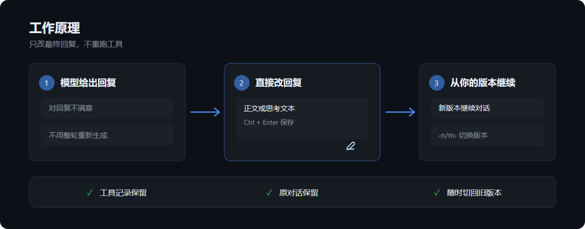

<p align="center">
  
</p>

<h1 align="center">The Last Word · 最终解释权</h1>

<p align="center">
  <a href="LICENSE"></a>
  
  
  
  
  <a href="https://github.com/Ylsssq926/dsh-last-word/stargazers"></a>
</p>

<p align="center">
  <a href="README.md">中文</a> ·
  <a href="README.en.md">English</a> ·
  <a href="README.ja.md">日本語</a> ·
  <a href="README.es.md">Español</a> ·
  <a href="README.fr.md">Français</a> ·
  <a href="README.de.md">Deutsch</a> ·
  <a href="README.ru.md">Русский</a> ·
  Português ·
</p>

Plugin DSH. Edite diretamente a última resposta do modelo e continue a conversa a partir da sua versão. Os registros de ferramentas são mantidos intactos; a conversa original é preservada.

## Funções

- **Editar resposta** — ícone de lápis ao lado da resposta. Reescreva o texto ou o raciocínio; ao salvar, uma nova versão é criada e a conversa continua a partir dela. `Ctrl / Cmd + Enter` salva, `Esc` cancela.
- **Editar pergunta** — ícone de lápis no fim do turno. Mude esta pergunta e regenere; funciona no meio da geração — a resposta anterior para sozinha.
- **Regenerar** — ícone de repetição no fim do turno. A mesma pergunta, o turno roda de novo.
- **Trocar versão** — ‹n/m› sob o turno alterna entre versões da mesma conversa, incluindo arquivadas. Uma entrada por conversa na barra lateral.

## Interface

<p align="center">
  
</p>

## Como funciona

<p align="center">
  
</p>

Cada salvamento cria um novo ramo com o registro completo de ferramentas. Volte a uma versão anterior quando quiser.

## Instalação

```bash
dsh plugin --profile web add github:Ylsssq926/dsh-last-word
```

Use `--profile desktop` para o app desktop. Reinicie o DSH e ative o plugin.

Para desenvolvimento local, vincule um diretório:

```bash
dsh plugin --profile web add link:/caminho/absoluto/para/model-response-editor
```

## Compatibilidade

- DSH `>=0.2.2-rc.1 <0.3.0`, web e desktop.
- Idiomas da interface: 中文, English, 日本語, Español, Français, Deutsch, Русский, Português. O tema segue o host.

## Desenvolvimento

```bash
pnpm install
npm test
```

## Licença

Apache-2.0. Mantenha a atribuição de [LICENSE](LICENSE) e [NOTICE](NOTICE) ao referenciar ou redistribuir.

掠蓝 · Grupo QQ: 676475076